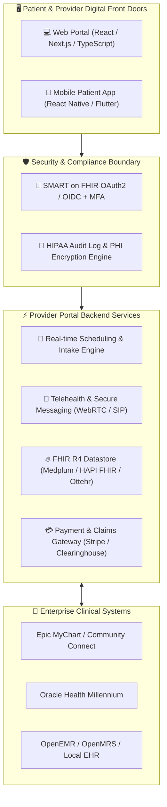

# 🏥 Awesome Healthcare Provider Portal

  

  
  
  
  
  
  
  

---

## 🌟 Introduction & Overview

Welcome to **Awesome Healthcare Provider Portal** — the definitive, SEO-optimized curated directory of enterprise SaaS solutions and open-source software powering **Healthcare Provider Portals**, **Patient Engagement Platforms**, **Electronic Health Records (EHR / EMR)**, **SMART on FHIR Interoperability**, and **Telehealth Workflows**.

Healthcare provider portals and patient-facing applications serve as the vital digital front door of modern medical ecosystems. These mission-critical systems bridge clinical data repositories with everyday consumer healthcare by offering:
- 📅 **Self-Service Scheduling & Intake**: Real-time appointment booking, pre-visit digital questionnaires, and check-in workflows.
- 📂 **Clinical Record & Lab Access**: Secure, bidirectional access to diagnostic reports, immunization records, radiology notes, and medication histories.
- 💬 **Secure Care Team Messaging & Telehealth**: HIPAA/GDPR-compliant asynchronous chat, video teleconsultations, and e-prescriptions.
- 💳 **Billing & Payment Transparency**: Online co-pay settlement, cost estimates, insurance claim status, and payment plans.
- ⚡ **FHIR R4 & SMART Interoperability**: Seamless API exchange with legacy hospital information systems (HIS) without proprietary vendor lock-in.

---

## 📑 Table of Contents

- [📊 Sector Overview & Market Dynamics](#-sector-overview--market-dynamics)
- [🏢 SaaS & Commercial Healthcare Provider Portals](#-saas--commercial-healthcare-provider-portals)
- [🔓 Open-Source Patient & Provider Portals](#-open-source-patient--provider-portals)
- [🏗️ Architectural Frameworks & Tech Stacks](#️-architectural-frameworks--tech-stacks)
- [🤝 How to Contribute](#-how-to-contribute)
- [💖 Support & Community](#-support--community)
- [📈 Star History](#-star-history)
- [⚖️ Disclaimer & Compliance](#️-disclaimer--compliance)

---

## 📊 Sector Overview & Market Dynamics

The global **patient portal and healthcare provider engagement market** is estimated at **$6.0B to $8.0B in 2026** and is accelerating at a robust **CAGR of 17%–21%**, projected to eclipse **$18B to $28B by 2032**, propelled by government interoperability mandates (CMS / ONC Cures Act Final Rule), consumerization of care, and rapid adoption of digital front doors.

The sector exhibits a distinct **barbell / moderately concentrated market structure**:
- 🏛️ **Enterprise Health Systems (High Concentration)**: The acute care and multi-facility hospital market is dominated by legacy EHR giants (*Epic Systems*, *Oracle Health / Cerner*, and *MEDITECH*), where deep clinical workflow integration and multi-million-dollar deployment costs create extreme vendor lock-in and high switching costs.
- 🌐 **Ambulatory & Outpatient Engagement (High Fragmentation)**: The independent clinic, specialty ambulatory practice, and third-party patient experience layers are highly fragmented, fostering fierce competition among specialized SaaS platforms (*Athenahealth*, *eClinicalWorks*, *NextGen*, *Tebra/Kareo*, *AdvancedMD*) and modern, headless open-source FHIR-first frameworks (*Medplum*, *Ottehr*, *OpenEMR*).

---

## 🏢 SaaS & Commercial Healthcare Provider Portals

The table below lists leading commercial Healthcare Provider Portals and Patient Engagement Platforms, sorted in descending order by **Company Size / Valuation / Revenue**:

| 🏷️ Product / Platform | 🏢 Company Size & Valuation | 💰 Starting Pricing Tier | 🆓 Free Tier / Free Trial Limits | 🩺 Core Healthcare Modules & Focus |
| :--- | :--- | :--- | :--- | :--- |
| **[ServiceNow Provider Portal](https://www.servicenow.com/)** | **~$190B Market Cap** *(~$10B+ Annual Revenue)* | **~$70 - $100/fulfiller seat/month** for base HCLS & CSM modules *(end-user patient portal self-service access is free)* | **Free forever Developer Instance (PDI)** with full admin sandbox access *(sleeps after 10 days of inactivity)*; 0 days standard enterprise production trial *(guided POC available via enterprise sales)* | Enterprise health system workflow automation, patient request routing, clinical credentialing, and multi-EHR care orchestration. |
| **[Epic MyChart](https://www.epic.com/)** | **~$45B Est. Valuation** *(~$5.0B Annual Revenue; Privately Held)* | **~$500 - $1,000/bed upfront** + **~$200/provider/month** maintenance via Community Connect *(MyChart app bundled free for all enrolled patients)* | **Free forever for end-patients** (unlimited record access & messaging); **0 days free trial for providers/hospitals** *(enterprise contract only; live customized sandbox demonstrations through sales)* | Dominant hospital network patient portal: test results, direct booking, telehealth visits, proxy care access, and bedside MyChart integration. |
| **[Cerner HealtheLife (Oracle Health)](https://www.oracle.com/health/)** | **$28.3B Acquisition Valuation** *(Parent Oracle $350B+ Cap; ~$5.9B Health Revenue)* | **Starting at ~$25/user/month** for baseline ambulatory cloud access; acute-care deployments range **$2M - $5M** initial setup | **Free forever for end-patients**; **0 days free trial for health organizations** *(structured proof-of-concept and guided product sandbox tours via Oracle enterprise sales)* | Enterprise patient engagement portal integrated with Cerner Millennium EHR, clinical document sharing, prescription renewals, and remote monitoring. |
| **[Athenahealth Patient Portal](https://www.athenahealth.com/)** | **$17.0B Valuation** *(Acquired by Bain Capital & H&F; ~$1.7B+ Revenue)* | **Starting at ~$140/provider/month base fee + 4% to 8% of monthly collections** *(athenaPatient mobile and web portal included)* | **Free forever for registered patients**; **0 days free trial for practices** *(interactive live software demonstration and practice collections diagnostic audit available)* | Ambulatory cloud EHR/PM portal featuring online bill payment, check-in questionnaires, automated appointment reminders, and telehealth visits. |
| **[eClinicalWorks (healow)](https://www.eclinicalworks.com/)** | **~$4.5B Est. Valuation** *(~$800M+ Annual Revenue; Privately Held)* | **$449/provider/month** for EHR-only plan *(includes healow patient portal & mobile apps)*; **$599/provider/month** for EHR + PM | **Free forever for patients on healow mobile & web**; **0 days free trial for practices** *(custom live scheduled system demonstration and specialty workflow walkthrough)* | Comprehensive ambulatory EHR with healow patient portal, smart appointment reminders, secure clinical messaging, and patient intake kiosk modes. |
| **[MEDITECH Expanse](https://www.meditech.com/)** | **~$2.0B Est. Valuation** *(~$550M Annual Revenue; Privately Held)* | **Starting at ~$3,500/month** for cloud-hosted *MEDITECH-as-a-Service (MaaS)* in community hospital settings | **Free forever for patients accessing the Expanse portal**; **0 days free trial for healthcare providers** *(custom product demos and architectural briefings via sales engineers)* | Web-based acute and ambulatory EHR portal with patient charts, diagnostic result viewing, pre-registration, virtual visits, and oncology workflows. |
| **[NextGen Patient Portal](https://www.nextgen.com/)** | **$1.8B Valuation** *(Acquired by Thoma Bravo; ~$653M Annual Revenue)* | **$299 - $499/provider/month** for NextGen Office *(includes Patient Experience Platform / PxP portal and online scheduling)* | **Free forever for patients**; **0 days free trial for practices** *(guided live discovery demo and practice technology needs assessment session)* | Integrated ambulatory portal for mid-to-large practices: digital intake, patient self-scheduling, HIPAA-compliant messaging, and electronic payments. |
| **[Veradigm FollowMyHealth](https://www.veradigm.com/)** | **~$1.1B Valuation** *(Formerly Allscripts; ~$600M Annual Revenue)* | **Component licensing starting at ~$59/prescriber/month**; full EHR + FollowMyHealth suite starts at **~$199 - $350/provider/month** | **Free forever for patients on FollowMyHealth portal & mobile app**; **0 days free trial for medical groups** *(custom product demonstration and revenue cycle analysis)* | Customizable enterprise patient engagement platform with telehealth, digital check-in, medical record aggregation, and proactive outreach. |
| **[AdvancedMD Patient Portal](https://www.advancedmd.com/)** | **$700M Valuation** *(Acquired by Marlin Equity; ~$180M Annual Revenue)* | **$130 - $399/provider/month** for *AdvancedMD Now* (mental health/specialty); standard medical bundles start at **$429/provider/month** | **30-day free trial** for *AdvancedMD Now* *(full access to scheduling, clinical notes, patient communication & claims)*; promotional 3-months free on select bundles | All-in-one cloud medical suite with patient self-scheduling, digital intake consent forms, online telemedicine room, and automated card-on-file billing. |
| **[Tebra / Kareo Patient Portal](https://www.tebra.com/)** | **~$600M Est. Valuation** *(Kareo + PatientPop Merger; ~$120M Annual Revenue)* | **Single modules start at $49 - $199/provider/month**; complete clinical EHR + patient portal starts at **$299 - $349/provider/month** *(for ≤100 claims/mo)* | **Free forever for patients on the portal**; **0 days free trial for clinics** *(on-demand video product tours and scheduled live personalized clinical demos)* | Built for independent medical practices: mobile-friendly patient portal, online reputation management, teleconsultations, and simple patient billing. |

---

## 🔓 Open-Source Patient & Provider Portals

A curated collection of self-hosted, sovereign, and developer-friendly open-source patient portals, EHR modules, and personal health record (PHR) aggregators. **Sorted in descending order by GitHub_Stars**:

- **[HospitalRun](https://github.com/HospitalRun/hospitalrun-frontend)**   
  🏥 Free, modern, and open-source hospital and patient management software designed for clinics and healthcare facilities in developing and low-resource environments. Features an intuitive patient intake portal, appointment scheduling, electronic medical records, laboratory orders, and billing workflows. Built with React and TypeScript.

- **[OpenEMR](https://github.com/openemr/openemr)**   
  🛡️ The world’s most popular open-source electronic health records (EHR) and medical practice management solution (ONC Complete Ambulatory Certified, HIPAA compliant). Includes a fully featured native Patient Portal supporting online appointments, secure provider messaging, digital intake questionnaires, lab result downloads, and multi-factor authentication (MFA).

- **[Fasten Health](https://github.com/fastenhealth/fasten-onprem)**   
  🔒 An open-source, self-hosted, personal and family electronic medical record (EMR) aggregator. Acts as a unified sovereign patient portal that connects securely to over 100,000+ US healthcare providers and hospital systems (Epic, Cerner, Athenahealth, VA) using SMART on FHIR to pull, normalize, and visualize diagnostic reports, vitals, and treatment history locally.

- **[Medplum](https://github.com/medplum/medplum)**   
  ⚡ Fast, open-source healthcare developer platform and patient portal framework built natively on HL7 FHIR. Provides pre-built React components (`@medplum/react`), compliant identity authentication, a high-performance FHIR datastore, automated clinical bots, and a white-label patient portal app for booking, communications, and telehealth.

- **[OpenMRS](https://github.com/openmrs/openmrs-core)**   
  🌍 Mature open-source enterprise electronic medical record platform deployed worldwide. Features an extensible modular architecture with community patient portal modules, FHIR RESTful web services, clinical decision support, and role-based access controls for multidisciplinary healthcare facilities.

- **[Ottehr Patient Portal](https://github.com/masslight/ottehr)**   
  🚀 Production-ready, open-source EHR and patient portal stack (MIT) designed for urgent care and virtual health clinics. Features a dedicated patient-facing website for self-scheduling, pre-visit paperwork, check-in queuing, SIP/WebRTC telemedicine video calls, and intake chat. Built on TypeScript, React, and FHIR.

- **[Mere Medical](https://github.com/cfu288/mere-medical)**   
  📱 Local-first, open-source personal health record (PHR) aggregator built on HL7 FHIR (MIT, AMIA FHIR App Finalist). Uses SMART on FHIR standalone OAuth2 authentication to directly sync health records from Epic MyChart, Cerner, Allscripts, and DrChrono onto the patient's local device without intermediary server storage.

- **[Bahmni Core](https://github.com/Bahmni/bahmni-core)**   
  🏥 Robust hospital information system (HIS) and EMR integrating OpenMRS, Odoo, and OpenELIS. Delivers end-to-end patient management, clinical encounter tracking, laboratory integration, and patient registration with strong HL7/FHIR interoperability.

- **[Canvas Medical Mobile Patient App](https://github.com/canvas-medical/mobile-patient-app)**   
  📲 Open-source FHIR-based cross-platform mobile patient portal application (React Native / TypeScript). Enables patients to schedule clinical visits, chat securely with their doctor, view medications and clinical summaries, and handle payments. Easily forkable and brandable.

- **[MyChart Takeout](https://github.com/jmandel/mychart-takeout)**   
  💾 Client-side open-source utility by Josh Mandel that exports all clinical and personal health data from any Epic MyChart patient portal session directly into standardized, machine-readable JSON/FHIR files—running entirely in the browser without third-party exposure.

- **[Halyos](https://github.com/hms-dbmi/halyos)**   
  🔬 Open-source SMART on FHIR web application developed at Harvard Medical School DBMI. Redesigns the patient portal experience by delivering rich, interactive longitudinal visualizations of lab results, vitals, and health trends for patients and providers.

- **[Portail Patient](https://github.com/SaamNoLimits/HealthCare)**   
  💻 Modern, accessible patient portal frontend built with Next.js, TypeScript, and Tailwind CSS. Features an interactive dashboard, appointment manager, allergy and medical condition trackers, and responsive mobile-first UI with dark/light themes.

- **[PulsePortal](https://github.com/shads-01/PulsePortal)**   
  🤖 Smart hospital portal featuring AI-assisted patient engagement, integrated Jitsi video teleconsultations, an AI health inquiry bot, automated prescription PDF rendering, room admission tracking, and role-based permissions for doctors, admins, and patients. Built with Laravel and React.

---

## 🏗️ Architectural Frameworks & Tech Stacks

Building a production-ready, sovereign healthcare provider portal requires a combination of robust clinical data standards, compliant communication, and responsive UI components:

### Recommended Open-Source Component Stacks

- 🏥 **Complete Turnkey Solution**: Combine **[OpenEMR](https://github.com/openemr/openemr)** (ONC-certified EHR + built-in patient portal) with **[HospitalRun](https://github.com/HospitalRun/hospitalrun-frontend)** for rapid hospital deployment.
- ⚡ **Headless Cloud-Native FHIR Stack**: Combine **[Medplum](https://github.com/medplum/medplum)** (FHIR backend + auth + React SDK) with **[Canvas Medical Mobile Patient App](https://github.com/canvas-medical/mobile-patient-app)** for branded web and mobile frontends.
- 📱 **Sovereign Local-First Patient Aggregator**: Deploy **[Fasten Health](https://github.com/fastenhealth/fasten-onprem)** and **[Mere Medical](https://github.com/cfu288/mere-medical)** to empower patients with device-local, multi-EHR record ownership without intermediary cloud risk.
- 🎥 **Virtual Urgent Care & Telehealth**: Use **[Ottehr](https://github.com/masslight/ottehr)** for digital check-in queuing paired with **[PulsePortal](https://github.com/shads-01/PulsePortal)** for AI-augmented teleconsultations.

---

## 🤝 How to Contribute

Contributions, project suggestions, and documentation enhancements are warmly welcomed!

1. 🍴 **Fork the Repository**: Click the `Fork` button at the top right of this page.
2. 🌿 **Create a Feature Branch**: `git checkout -b feature/add-new-portal`
3. 📝 **Edit the README.md**: Follow the existing format (include product/repo name, verified URL, clear description, pricing details, and Stars_Badges where applicable).
4. 🔍 **Verify Data Quality**: Ensure license terms, links, and pricing quotes are current and accurate.
5. 🚀 **Submit a Pull Request**: Provide a clear explanation of your additions or changes in your PR description.

---

## 💖 Support & Community

If you find **Awesome Healthcare Provider Portal** helpful for your health-tech research, clinic deployment, or engineering architecture:

- ⭐ **Star this repository** to help other healthcare developers, informaticians, and CIOs discover it!
- 🍴 **Fork and share** it with your clinical technology team and peers.
- ☕ **Support the maintainer**: If you'd like to back ongoing open-source curation and health-tech tool development, you can sponsor the project via GitHub Sponsors:

  

Thank you for being part of the open healthcare informatics community! 🙏

---

## 📈 Star History

---

## ⚖️ Disclaimer & Compliance

- 📋 **Community-Curated**: This directory is an independent, community-maintained informational resource and does not constitute an endorsement, medical recommendation, or legal certification of any platform.
- 🛡️ **HIPAA, GDPR & PHI Regulatory Requirements**: Software handling Protected Health Information (PHI) or Electronic Protected Health Information (ePHI) must comply with stringent regulatory frameworks, including the US Health Insurance Portability and Accountability Act (HIPAA), Health Information Technology for Economic and Clinical Health (HITECH) Act, EU General Data Protection Regulation (GDPR), and local medical device data legislation.
- 🔐 **Security Hardening**: Open-source deployments require proper architectural controls—including TLS 1.3 encryption in transit, AES-256 encryption at rest, secure secret vaults, strict role-based access control (RBAC), multi-factor authentication (MFA), and audit log archiving.
- 📜 **Licensing Validation**: Prior to commercial integration or deployment in clinical practice, independently review each platform's software license (e.g., MIT, Apache-2.0, AGPL-3.0, or proprietary commercial SLAs).

---

  <b>Built with care for Healthcare CIOs, Clinical Informaticians, Health-Tech Developers, and Patient Advocates worldwide. 🌐</b>

